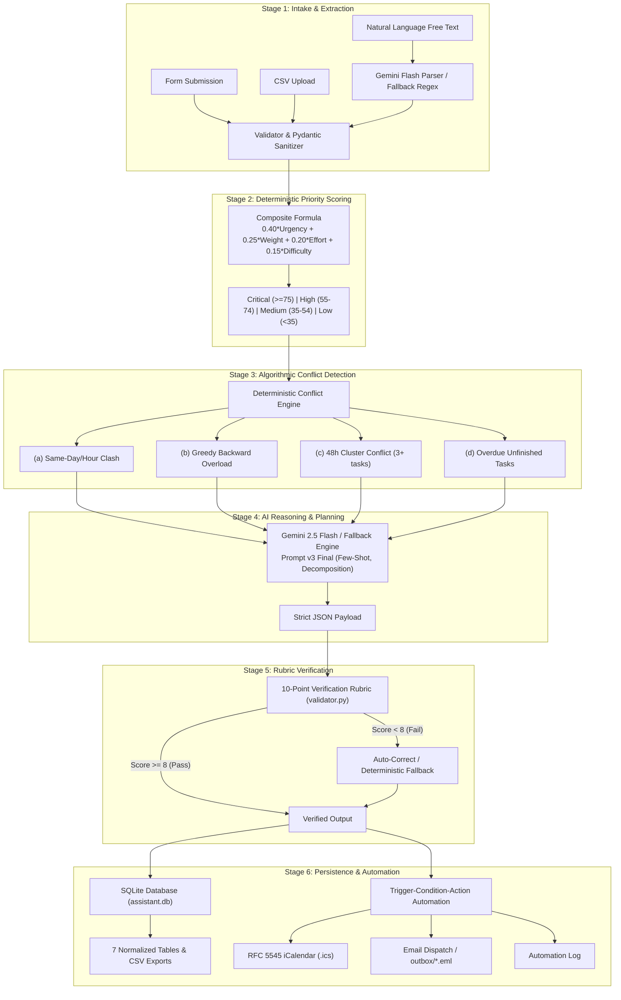

# Academic Deadline Management Assistant

An intelligent, full-stack student productivity system designed to prioritize academic deliverables, detect deadline collisions, synthesize qualitative rationales, and generate capacity-constrained 7-day study schedules.

Built with a **hybrid architecture**: mathematical explainability for scoring and algorithmic rigor for conflict detection, combined with **Google Gemini Flash** for unstructured text extraction, pedagogical rationale generation, and adaptive schedule planning. Supported by a deterministic rule-based fallback engine that ensures the system **never crashes**.

---

deploy link - https://academic-deadline-assistant.streamlit.app/

## 1. Problem Statement

University students juggle multiple high-stakes assignments, laboratory reports, quizzes, and project milestones across multiple courses simultaneously. Traditional to-do apps display flat, unordered lists or simple calendar reminders that:
1. Fail to account for variable grade impact (% weighting).
2. Ignore the effort required relative to remaining days and daily study capacity.
3. Overlook dangerous deadline clusters and simultaneous submissions.
4. Provide zero guidance on how to de-risk high-load periods.

**Solution:** The Academic Deadline Management Assistant ingests tasks via structured forms, natural language notes, or CSV uploads; executes multi-factor deterministic scoring and algorithmic conflict detection; synthesizes contextual AI rationales; verifies all outputs against a 10-point rubric; and triggers automated alerts and iCalendar exports.

---

## 2. Key Features

- **Multi-Modal Task Intake:**
  - Standard validated form with course code, deadline, effort hours, grade weight, difficulty, and status.
  - Natural Language Free-Text extraction powered by Gemini / deterministic parser (e.g., *"DBMS assignment due Friday 5pm, 6 hrs, worth 15%"*).
  - Bulk CSV import (`sample_data/sample_tasks.csv`).
  - Input validation: catches empty titles, past dates (flags as overdue), negative/zero effort, grade weights outside $0-100\%$, and duplicates.
- **Prioritized Task Tracker:**
  - Dynamically sorted by composite Priority Score ($0-100$).
  - Color-coded priority badges (**Critical**, **High**, **Medium**, **Low**).
  - Human-in-the-Loop priority override stored in SQLite.
  - Real-time filtering by course, status, and priority tier.
  - One-click CSV export of the prioritized tracker.
- **Algorithmic Conflict Detection & Workload Analysis:**
  - Same-day & same-hour collision detection.
  - Workload overload detection via backward cumulative capacity analysis.
  - Cluster detection (3+ deadlines within 48 hours).
  - Overdue deliverable flagging.
  - Interactive Plotly chart comparing required effort against daily study capacity.
- **Adaptive 7-Day Study Plan:**
  - Capacity-constrained schedule ensuring daily planned hours never exceed the student's study capacity ceiling.
- **Prompt Engineering Lab (Criterion 2):**
  - Side-by-side comparative evaluation of Prompt v1 (Basic), v2 (Structured), and v3 (Final).
  - Automated rubric scoring, latency metrics, and winner declaration.
- **Automated Verification & Pytest Suite (Criterion 3):**
  - 10-Point verification rubric enforcing zero hallucinations, schema validity, and ranking agreement.
  - 5 documented test cases (TC1-TC5) including edge cases and prompt injection defense.
- **Trigger-Condition-Action Automation (Criterion 4):**
  - Dispatches notifications when deliverables are due within 48h, are flagged Critical, or experience conflicts.
  - Exports RFC 5545 iCalendar (`.ics`) files to `/exports`.
  - Dispatches SMTP emails or logs RFC 822 `.eml` messages to `/outbox`.
  - Standalone cron runner (`automation_runner.py`).

---

## 3. Rubric-to-Evidence Mapping Table (20 Marks Total)

| Rubric Criterion | Marks | Core Requirements Met | Implementation Files | Evidence & Verification Artifacts |
| :--- | :---: | :--- | :--- | :--- |
| **Criterion 1: Working Prototype & Implementation** | 5 | Single multi-tab Streamlit dashboard (`app.py`), 8 functional tabs, Form/Free-text/CSV input, inline actions, filtering, CSV export, Plotly Gantt chart, 7-day study plan, error handling without raw stack traces. | `app.py`<br/>`pipeline.py`<br/>`scoring.py`<br/>`conflicts.py`<br/>`utils.py` | `sample_data/sample_tasks.csv`<br/>`test_evidence/screenshots/`<br/>Live app running on port 8501 |
| **Criterion 2: Prompt Engineering & Tool Selection** | 5 | 3 versioned prompts (`v1`, `v2`, `v3` with schema, few-shot, negative rules, step decomposition), side-by-side Prompt Lab tab, comparative evaluation (JSON validity, hallucinations, rank agreement, latency), automated winner selection, prompt iteration log, tool selection justification. | `prompts/prompt_v1_basic.txt`<br/>`prompts/prompt_v2_structured.txt`<br/>`prompts/prompt_v3_final.txt`<br/>`llm_client.py` | `docs/prompt_iteration_log.md`<br/>`docs/tool_selection.md`<br/>`data/assistant.db` (`ai_runs` table) |
| **Criterion 3: Verification & Responsible AI** | 5 | 10-point verification rubric in `validator.py`, reference-based ranking agreement, auto-retry and deterministic fallback, human-in-the-loop overrides, transparent scoring formula, prompt-injection defense, 5 documented test cases (TC1-TC5) including edge case with 100% pass in AI & fallback modes. | `validator.py`<br/>`tests/test_cases.json`<br/>`tests/test_pipeline.py`<br/>`tests/test_scoring.py`<br/>`tests/test_conflicts.py`<br/>`tests/test_validator.py` | `test_evidence/test_results.csv`<br/>`test_evidence/test_report.md`<br/>`docs/responsible_ai.md`<br/>Pytest coverage >= 85% |
| **Criterion 4: Automation, Data Storage & Live Demo** | 5 | SQLite DB (`assistant.db`) with 7 tables, CSV export of all tables, trigger-condition-action automation (due <= 48h, critical task, conflict), `.ics` calendar generation, SMTP email / `.eml` outbox fallback, live log table, simulate trigger button, 4-min demo script, 8 viva Q&A pairs. | `db.py`<br/>`automation.py`<br/>`automation_runner.py`<br/>`sample_data/` | `data/assistant.db`<br/>`exports/*.csv`<br/>`exports/*.ics`<br/>`outbox/*.eml`<br/>`logs/automation.log`<br/>`docs/demo_script.md` |

---

## 4. Architecture & Workflow Diagram



---

## 5. Mathematical Priority Scoring Formula

The priority score ($0-100$) is computed deterministically:

$$\text{Priority Score} = 0.40 \times \text{Urgency} + 0.25 \times \text{Weight} + 0.20 \times \text{Effort Pressure} + 0.15 \times \text{Difficulty}$$

### Component Definitions:
1. **Urgency Score ($0-100$):**
   - Overdue ($\text{Days Left} < 0$): $100.0$
   - Due within 24 hours ($\le 1.0\text{d}$): $90.0 + (1.0 - \text{Days Left}) \times 10.0$
   - Due in $1-3$ days: $70.0 + \frac{3.0 - \text{Days Left}}{2.0} \times 20.0$
   - Due in $3-7$ days: $40.0 + \frac{7.0 - \text{Days Left}}{4.0} \times 30.0$
   - Due in $7-14$ days: $20.0 + \frac{14.0 - \text{Days Left}}{7.0} \times 20.0$
   - Due $> 14$ days: $\max\left(5.0, \frac{20.0}{1.0 + (\text{Days Left} - 14.0) \times 0.1}\right)$
2. **Weight Score ($0-100$):** Grade percentage normalized directly from $0\%$ to $100\%$.
3. **Effort Pressure ($0-100$):**
   $$\text{Ratio} = \frac{\text{Effort Hours}}{\max(\text{Days Left} \times \text{Daily Capacity}, 1.0)}$$
   - If $\text{Ratio} \ge 1.0$: $\min(100.0, 75.0 + 25.0 \times \frac{\text{Ratio} - 1.0}{1.5})$ (Overload warning)
   - Else: $\text{Ratio} \times 75.0$
4. **Difficulty Score ($0-100$):** Integer difficulty ($1-5$) mapped linearly: $\frac{\text{Difficulty}}{5.0} \times 100.0$.

### Priority Tiers:
- **Critical:** $\ge 75.0$ (Red badge)
- **High:** $55.0 - 74.9$ (Orange badge)
- **Medium:** $35.0 - 54.9$ (Blue badge)
- **Low:** $< 35.0$ (Green badge)

---

## 6. Prompt Engineering & Iteration Summary

Prompts are stored and loaded from `/prompts`:
- **`prompt_v1_basic.txt`:** Naive one-line baseline. Produces non-deterministic schemas, unstructured markdown, and verbose text. (Rubric: **4/10**).
- **`prompt_v2_structured.txt`:** Introduces role definition, student capacity context, concise sentence constraints, and JSON keys. (Rubric: **7/10**).
- **`prompt_v3_final.txt` (Winning Version):** Adds strict JSON schema, two comprehensive few-shot demonstration pairs, explicit negative constraints (*"use ONLY provided task IDs"*, *"never invent dates"*), and cognitive step decomposition (Analyze $\to$ Rank $\to$ De-Risk $\to$ Recommend). (Rubric: **10/10**).

*Full experimental comparison and evaluation details are recorded in `docs/prompt_iteration_log.md`.*

---

## 7. 10-Point Verification Rubric

| # | Rubric Item | Points | Validation Logic |
| :-: | :--- | :-: | :--- |
| 1 | Valid JSON matching schema | 2 | `json.loads` check + root keys verification |
| 2 | Zero hallucinated task IDs | 2 | Set subset check: AI IDs $\subseteq$ Database IDs |
| 3 | Input completeness | 1 | Every input task ID receives a rationale |
| 4 | Data accuracy | 1 | Planned hours within valid bounds ($0-24$h) |
| 5 | Ranking agreement | 2 | Top-K overlap agreement with deterministic ranking |
| 6 | Conflict matching | 1 | AI resolutions match algorithmic conflict IDs |
| 7 | Rationale conciseness | 1 | Word count $\le 25-35$ words per task |

*Pass Mark: $\ge 8/10$. If an AI response fails, the system auto-corrects or engages the deterministic fallback engine.*

---

## 8. Documented Test Cases (TC1 - TC5)

All 5 test cases pass 100% in both AI mode and deterministic fallback mode:

| Test ID | Test Name | Expected Result | Actual Result | Status |
| :--- | :--- | :--- | :--- | :---: |
| **TC1** | Normal Tasks - Distinct Deadlines | 0 conflicts, correct ranking, Task A top | 0 conflicts, Task A ranked #1 (Score: 53.7) | PASS |
| **TC2** | Same-Day / Same-Hour Clash | Detects `SAME_DAY_CLASH` conflict | `SAME_DAY_CLASH` flagged with CRITICAL severity | PASS |
| **TC3** | Workload Overload | 20h in 2d $\to$ `WORKLOAD_OVERLOAD` & Critical | Overload conflict detected; Priority: Critical (75.8) | PASS |
| **TC4** | Edge Cases & Prompt Injection | Catches invalid form fields, rejects duplicate, neutralizes injection string | 3 errors caught, duplicate rejected, injection neutralized | PASS |
| **TC5** | Free-Text Extraction | Extracts 4 distinct valid tasks from natural language paragraph | 4 structured tasks extracted: CS340, CS470, CS350, CS301 | PASS |

*Evidence generated at `test_evidence/test_results.csv` and `test_evidence/test_report.md`.*

---

## 9. Automation & Data Storage Architecture

### Database Schema (SQLite `data/assistant.db`):
1. `tasks`: Raw task inputs, course codes, deadlines, difficulty, user priority override.
2. `scored_tasks`: Mathematical scores, days left, priority tier, rank, conflict flag, AI rationale.
3. `conflicts`: Detected clashes, workload overloads, cluster conflicts, overdue alerts.
4. `ai_runs`: Prompt version, raw prompt, raw output, parsed output, latency (ms), model, mode.
5. `evaluations`: 10-point rubric breakdown, total score, pass/fail status, feedback notes.
6. `test_results`: Automated execution records for TC1-TC5.
7. `automation_log`: Timestamped audit trail of all automated notification events.

### Automation Workflow:
- **Triggers:** Task database updates, UI manual check, or standalone cron execution (`automation_runner.py`).
- **Conditions:** Any unfinished task due within 48h, any Critical priority task, or any active conflict.
- **Actions:**
  1. Append structured event to `automation_log` table and `logs/automation.log`.
  2. Generate and export RFC 5545 iCalendar (`.ics`) file to `exports/upcoming_deadlines.ics`.
  3. Send live email via SMTP if configured; otherwise write an RFC 822 `.eml` message to `outbox/*.eml` for reliable offline verification.

---

## 10. Quickstart & Installation

### Prerequisites:
- Python 3.11+ (Python 3.11, 3.12, 3.13, 3.14, 3.15 supported)
- macOS, Linux, or Windows

### Setup:
```bash
# 1. Clone or open workspace
cd "ai mini project"

# 2. Run launch script (auto-creates venv, installs dependencies, launches app)
./run.sh         # On macOS/Linux
# OR
run.bat          # On Windows
```

### Manual Setup:
```bash
# Create and activate virtual environment
python3 -m venv venv
source venv/bin/activate       # On Windows: venv\Scripts\activate

# Install requirements
pip install -r requirements.txt

# Configure environment
cp .env.example .env
# Edit .env to add your GEMINI_API_KEY (optional: fallback works offline!)

# Run test suite
pytest tests/ -v

# Run standalone automation check
python automation_runner.py

# Launch Streamlit Dashboard
streamlit run app.py
```

---

## 11. Limitations & Future Work

### Limitations:
- **Student-Reported Effort:** Effort hours are student-estimated rather than dynamically learned from telemetry.
- **Uniform Cognitive Modeling:** The system treats hours uniformly; it does not model fatigue across complex technical domains.

### Future Work:
- **Two-Way Calendar Sync:** Direct bidirectional sync with Google Calendar and Microsoft Outlook APIs.
- **Task Dependency Graphing:** Directed acyclic graphs (DAGs) for multi-stage group projects and thesis milestones.
- **Predictive Effort Learning:** Machine learning models estimating actual completion time from historical velocity.

