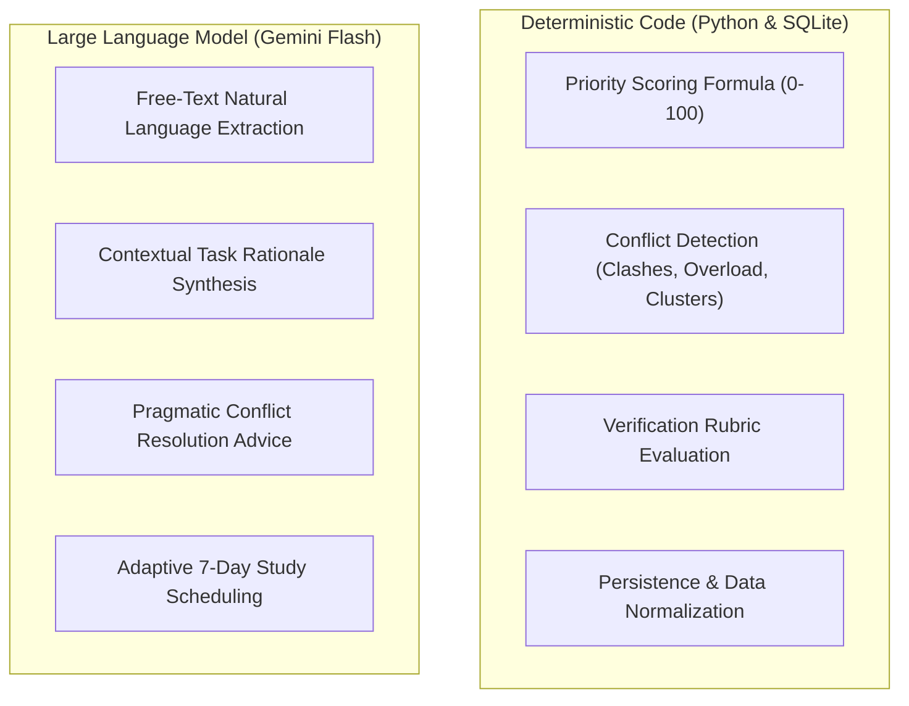

# Architectural Justification & Tool Selection

This document provides technical justification for the hybrid architectural design of the Academic Deadline Management Assistant, detailing why deterministic algorithms handle scoring and conflict detection while the Large Language Model (Gemini Flash) is targeted exclusively for extraction, qualitative synthesis, and adaptive planning.

---

## 1. Why a Hybrid Architecture? (Deterministic Code vs. LLM)

A common pitfall in AI productivity applications is delegating arithmetic prioritization and calendar conflict verification to an LLM. In this project, responsibilities are split based on computational strengths:

### Why Scoring & Conflict Detection MUST Be Deterministic:
1. **Mathematical Reproducibility & Fairness:**
   Academic task ranking impacts student study decisions. A student needs full transparency into why an assignment is ranked #1 versus #4. If priority shifted between sessions due to stochastic temperature sampling, user trust would collapse. The formula ($0.40 \cdot \text{Urgency} + 0.25 \cdot \text{Weight} + 0.20 \cdot \text{Effort} + 0.15 \cdot \text{Difficulty}$) guarantees explainability, consistency, and auditable scoring.
2. **Computational Precision in Conflict Detection:**
   Detecting whether 20 hours of work exceed an 8-hour window or whether 3 deadlines occur within a 48-hour sliding interval is an exact temporal calculation. LLMs frequently hallucinate time math, struggle with leap days/timezones, and miss boundary conditions. Algorithmic code operates in $O(N \log N)$ time with 100% precision.
3. **Latency and Cost Efficiency:**
   Scoring 50 tasks deterministically in Python takes $<1$ millisecond and incurs $\$0$ in API costs. Making repetitive API calls for sorting would introduce unacceptable latency and rate-limit risks.

### Why LLM is Ideal for Extraction, Rationale, and Planning:
1. **Unstructured Text Extraction:** Students often copy assignment notes from syllabi, Slack, or emails (e.g. *"DBMS assignment due Friday 5pm, 6 hrs, worth 15%"*). Regex alone struggles with natural human language variability. The LLM excels at extracting semantic entities and mapping them to a typed JSON schema.
2. **Contextual Pedagogical Rationale:** Students don't just want a number; they want guidance on *why* a deliverable matters (e.g., explaining trade-offs between a high-stakes exam and a short overdue quiz).
3. **Adaptive 7-Day Study Plan:** Distributing remaining effort across calendar days while accommodating objectives, study days, and capacity constraints leverages the reasoning and creative structuring capabilities of the LLM.

---

## 2. Why Google Gemini Flash (`gemini-2.5-flash` / `gemini-3.8-flash`)?

1. **Low Latency & High Throughput:**
   Gemini Flash models provide sub-second generation times (often 300-800ms), essential for responsive real-time dashboard interactions.
2. **Native JSON Schema Enforcement:**
   Gemini's structured outputs (`response_mime_type="application/json"`) guarantee that outputs adhere strictly to the JSON schema without extraneous markdown commentary.
3. **Cost-Effective Scalability:**
   Academic tools require lightweight, cost-effective inference so students and universities can run them at scale without exorbitant cloud costs.
4. **Resilience & Fallback Safety:**
   Our implementation pairs the Gemini client with a deterministic rule engine fallback. If an API key is missing or quotas are exhausted, the system transitions to offline rule-based operation with zero downtime.

