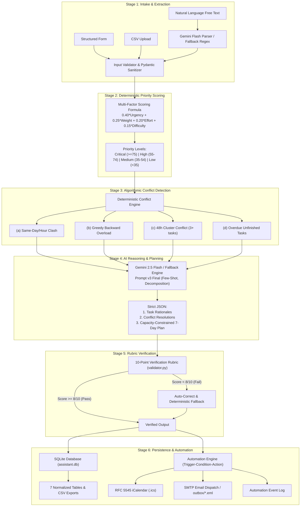

# Academic Deadline Management Assistant - Workflow Architecture

The system processes student workload through a 6-stage end-to-end pipeline designed for mathematical rigor, deterministic explainability, and intelligent contextual assistance.

---

## Stage Descriptions
1. **Stage 1 (Intake & Extraction):** Normalizes inputs from interactive form submissions, CSV uploads, or free-text syllabus descriptions. Employs prompt-injection defenses and type constraints.
2. **Stage 2 (Priority Scoring):** Computes normalized 0-100 priority scores deterministically using an explainable mathematical formula combining urgency, grade weight, effort pressure, and course difficulty.
3. **Stage 3 (Conflict Detection):** Algorithmic rules independently evaluate deadlines against student daily study capacity to detect same-day collisions, capacity deficits, deadline clusters, and overdue tasks.
4. **Stage 4 (AI Reasoning):** Generates concise rationales per task, actionable conflict resolutions, and an adaptive 7-day schedule respecting daily study hours.
5. **Stage 5 (Rubric Verification):** Evaluates AI output against 7 rubric checks (10 points total). Guarantees zero task hallucinations and ranking agreement; engages deterministic fallback if score < 8/10.
6. **Stage 6 (Persistence & Automation):** Persists all states to SQLite, generates downloadable iCalendar files, and dispatches automated email alerts or outbox files when urgent conditions are met.

